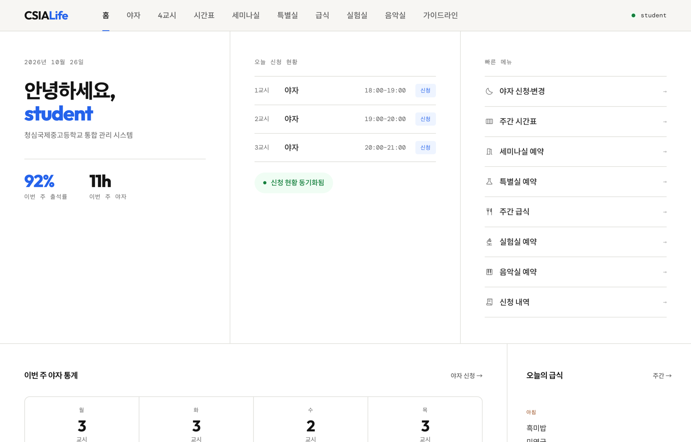
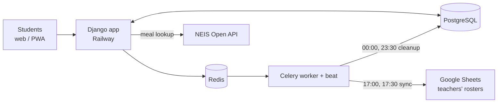
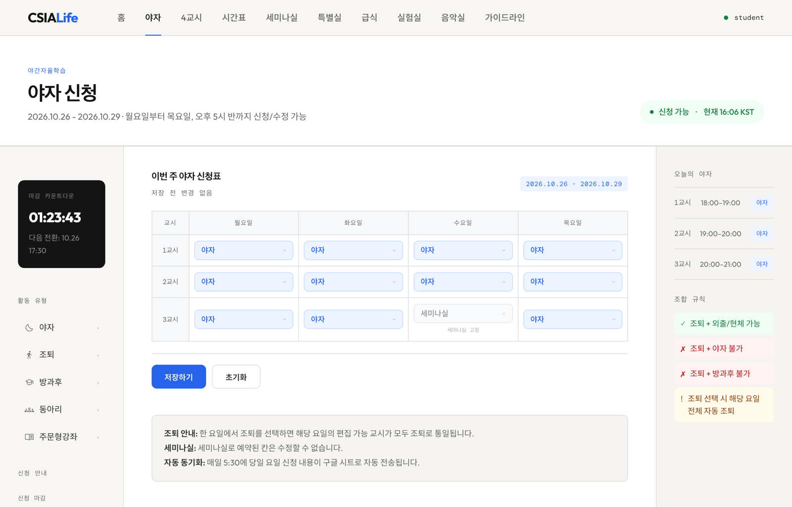
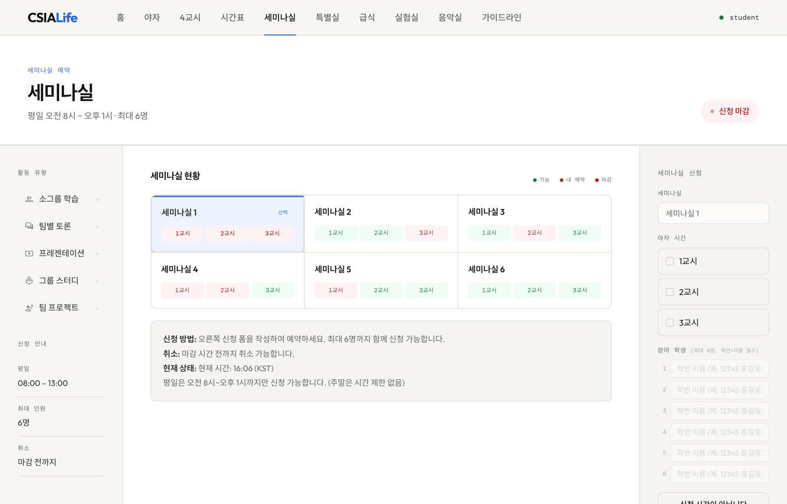
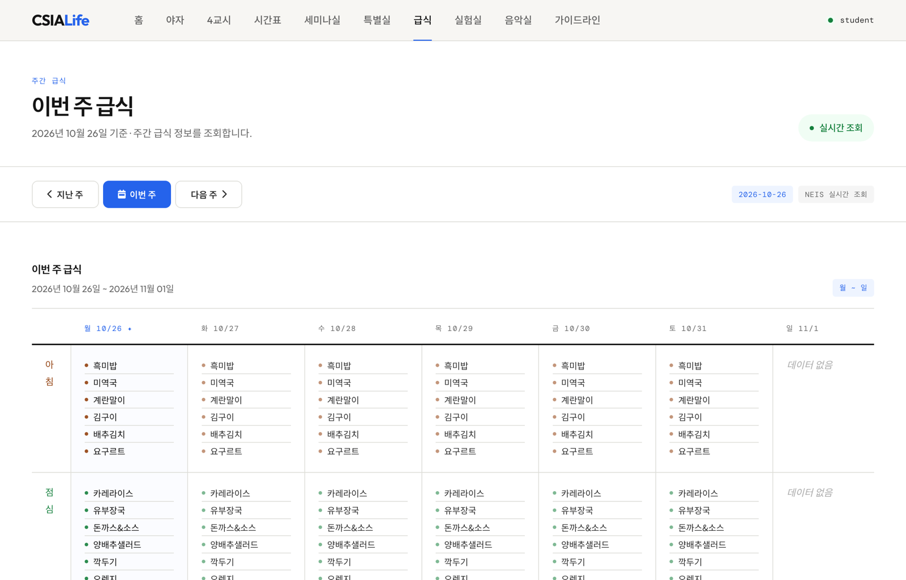
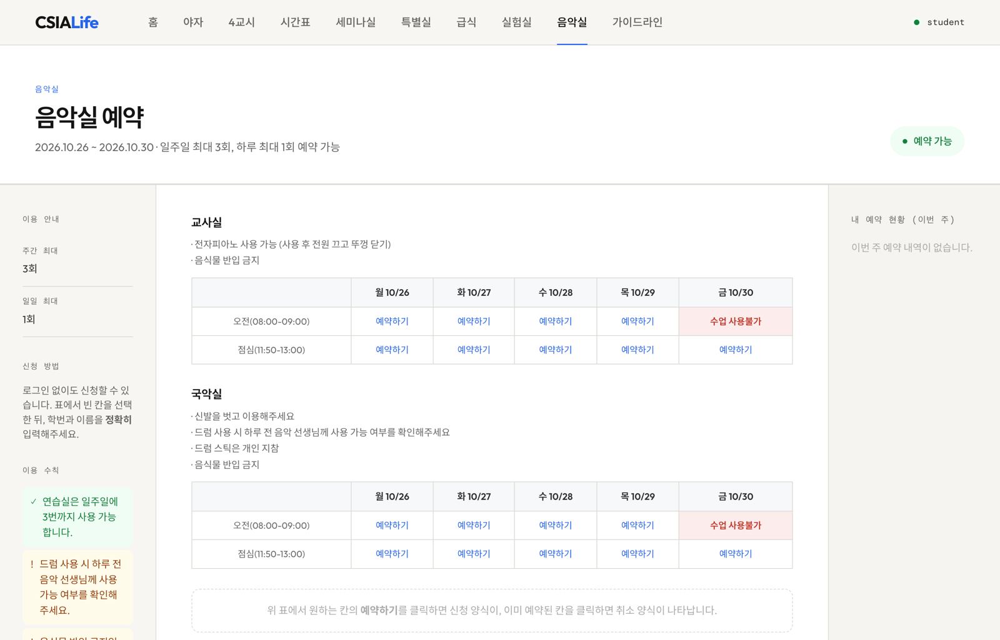

# CSIALife

**The schoolwide platform students at CheongShim International Academy use for study hall requests, seminar room bookings, meals, and room reservations.**

[csialife.com](https://csialife.com) · 600+ users · 2025 – present

> The source code stays private because the production system handles real student records. This repository documents the design and shows the interface with fictional demo data.

  

## The problem

Every evening, students declared what they would do during each night study period: study hall, an after-school course, an outing, or a seminar room session. Teachers collected these by hand every day and typed them into spreadsheets. CSIALife replaced that process, but as features piled up, the study hall request logic developed a structural bug that left ghost records in the data teachers relied on.

## My role

**Leader & Developer.** I started as a co-developer alongside senior students. I now lead development and maintenance.

- Rebuilt the study hall request logic from scratch after the ghost record bug.
- Unified seminar room booking into a single booking model and added daily cleanup jobs.
- Moved scheduled work (sheet sync, cleanup) onto Celery and deployed the stack on Railway with PostgreSQL.
- Added lab, music room, and meal features, plus a PWA and token API for mobile access.

## Architecture

| Scheduled job | When | What it does |
|:--|:--|:--|
| Study hall sync | 17:00, 17:30 | Writes the day's requests into the teachers' Google Sheets |
| Seminar sync | 13:00 | Writes seminar room bookings to the sheet |
| Daily cleanup | 00:00, 23:30 | Clears past bookings and the day's request data so nothing lingers into the next day |

## Screens

<table>
<tr>
<td width="50%">
Study hall requests, Monday to Thursday
</td>
<td width="50%">
Seminar room availability
</td>
</tr>
<tr>
<td width="50%">
Weekly meals from the NEIS API
</td>
<td width="50%">
Music room reservations
</td>
</tr>
</table>

## Stack

Django · Celery · Redis · PostgreSQL · Google Sheets API · NEIS Open API · Railway

All names and data in the screenshots are fictional.
