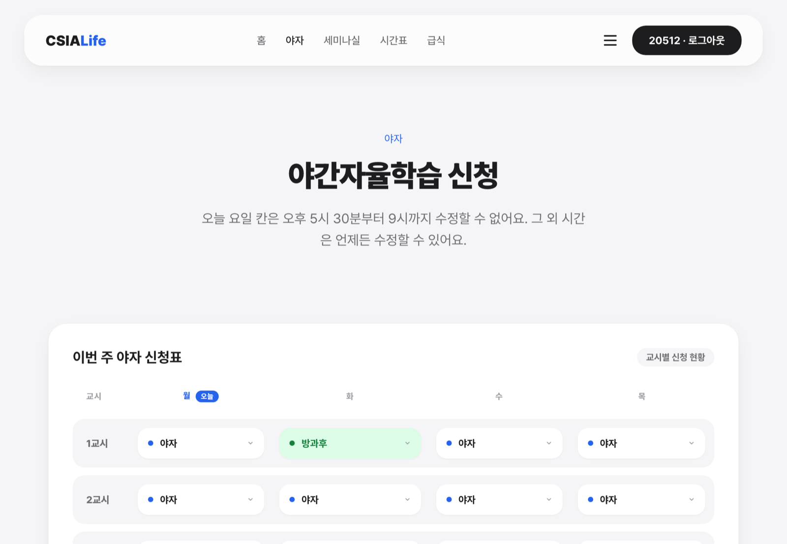
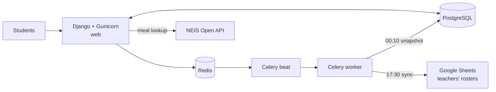
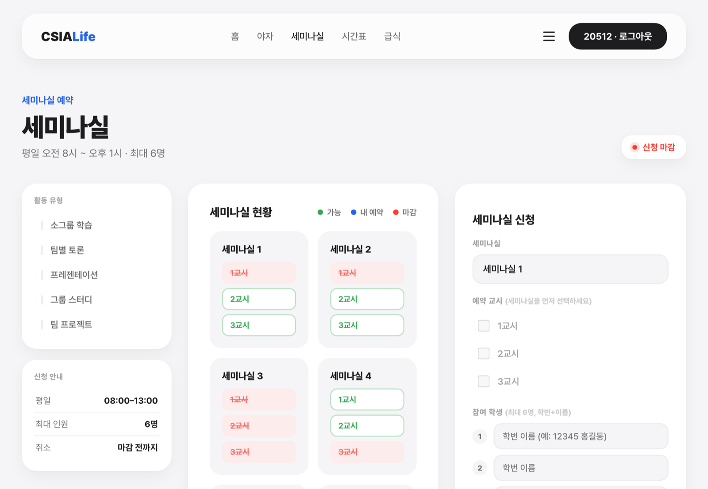
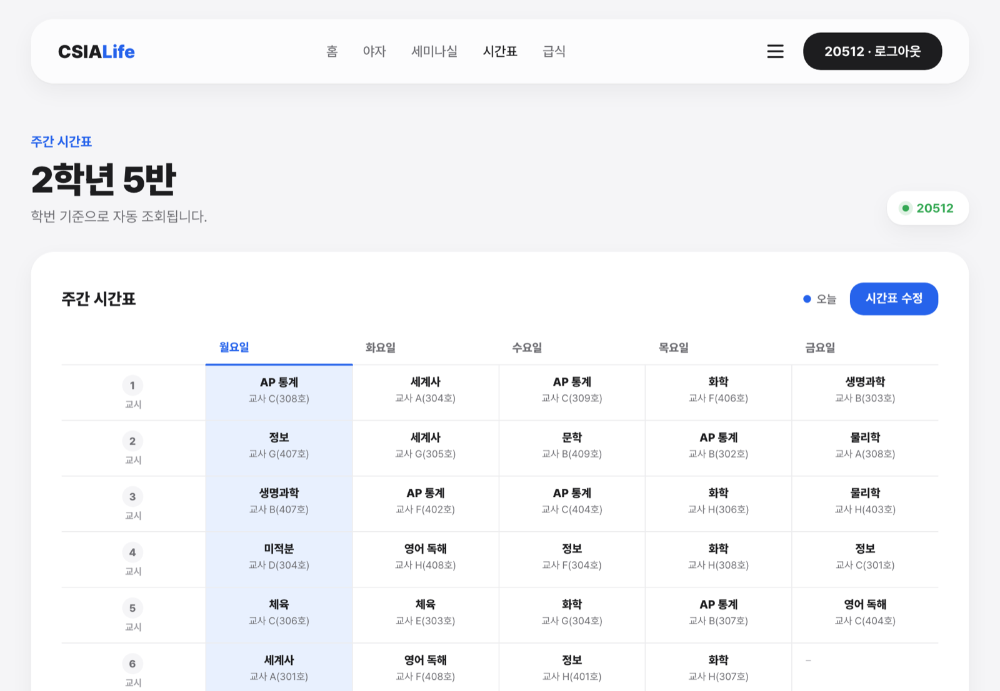
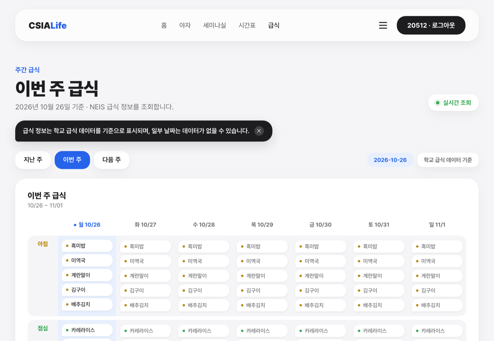
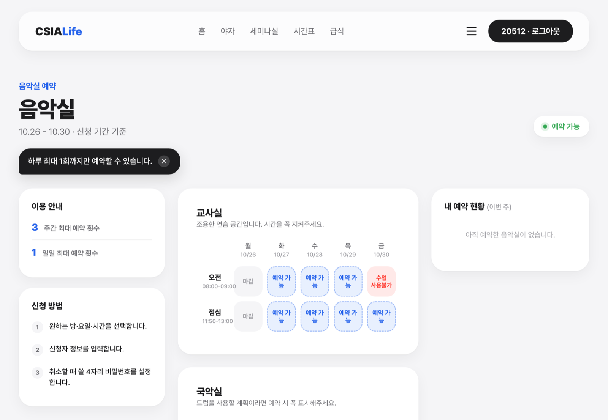

# CSIALife

**The schoolwide platform students at CheongShim International Academy use for night study requests, seminar room bookings, timetables, meals, and music room reservations.**

[csialife.com](https://csialife.com) · 600+ users · 2025 – present

> The source code stays private because the production system handles real student records. This repository documents the design and shows the current version with fictional demo data.

  

## The problem

Every evening, students declare what they will do in each night study period: self-study, an after-school course, an outing, or a seminar room session. Teachers used to collect these by hand every day and type them into spreadsheets. CSIALife replaced that process, but as features piled up in the first version, the request logic developed a structural bug that left ghost records in the data teachers relied on.

## My role

**Leader & Developer.** I started as a co-developer alongside senior students and now lead development and maintenance.

- Rebuilt the night study request logic after the ghost record bug.
- Started a new codebase for the 2026–27 school year, which is the version running at csialife.com today.
- Run the system on Railway as three processes (web, Celery worker, Celery beat) on PostgreSQL and Redis.
- Added daily snapshots of the teachers' sheet history so past records survive even after Google merges old versions.

## Architecture

| Scheduled job | When | What it does |
|:--|:--|:--|
| Night study sync | 17:30 | Re-syncs every active request for the day into the teachers' sheet |
| Seminar sync | 13:00 | Writes the day's seminar room bookings to the sheet |
| Sheet history snapshot | 00:10 | Saves the previous day's sheet version to the database |
| Seminar reset | 00:30 | Clears past bookings so the next day starts clean |

## Screens

<table>
<tr>
<td width="50%">
Seminar room booking
</td>
<td width="50%">
Timetable matched to each student ID
</td>
</tr>
<tr>
<td width="50%">
Weekly meals from the NEIS API
</td>
<td width="50%">
Music room reservations
</td>
</tr>
</table>

## Stack

Django · Gunicorn · Celery · Redis · PostgreSQL · Google Sheets API · NEIS Open API · Railway

All names, timetables, and menus in the screenshots are fictional.
